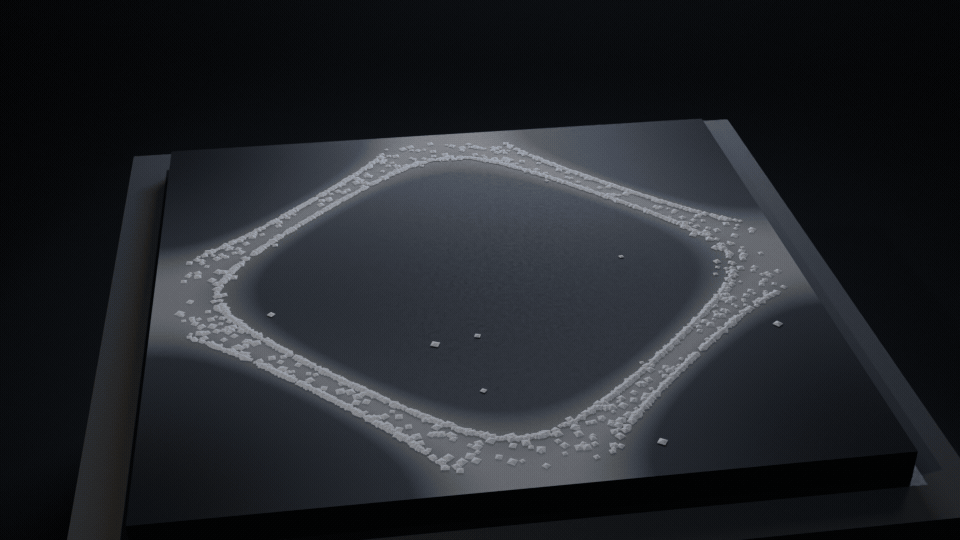

# chladni-cinema — Sesin Şekilleri / The Shapes of Sound



## EN

A dark hall. A black brushed-steel square plate rests on a stone pedestal.
A hard side light rakes across it. And on the plate, 2400 grains of sand gather
into the **nodal lines** of the plate's vibration — the "shapes of sound"
that Ernst Chladni discovered in 1787.

Nothing here is faked. The plate is solved as a **2D wave equation with an
FDTD leapfrog scheme** (`chladni.py`); the drive frequency is locked onto a
measured **resonance of the plate**; the sand is a **particle simulation**
whose grains are shaken by the local vibration amplitude, slide down the
vibration gradient and *stick* wherever the plate stops moving (the classical
Chladni capture criterion). Every grain you see in the render is a grain
integrated by that solver, every frame.

The film is one continuous simulation. The plate starts in its first driven
mode (1.414 Hz → a closed ring of sand), the drive then switches to the next
mode (2.000 Hz → a square grid of sand). The sand is *released* by the new
frequency and migrates to the new nodal lines while the camera cranes upward.
**When the music changes, the plate shows another face.**

## TR

Karanlık bir salon. Siyah fırçalanmış çelikten kare bir plaka, taş bir kaidenin
üzerinde. Sert bir yan ışık plakanın üzerini süpürüyor. Ve plakanın üzerinde
2400 kum tanesi, plakanın **nodal çizgilerinde** toplanıyor — 1787'de Ernst
Chladni'nin keşfettiği "sesin şekilleri".

Burada hiçbir şey sahte değil. Plaka, **FDTD leapfrog** yöntemiyle çözülen 2B
dalga denklemi olarak hesaplanıyor (`chladni.py`); sürücü frekansı, plakanın
**ölçülmüş rezonansına** kilitleniyor; kum ise yerel titreşim genliğiyle
sarsılan, titreşim gradyanı boyunca "yokuş aşağı" akan ve plaka durduğu yerde
**yapışan** (klasik Chladni yakalama ölçütü) bir tane simülasyonu. Render'daki
her tanе, o çözücünün integrasyonudur; her kare öyle.

Film tek bir sürekli simülasyondur. Plaka ilk sürülen modunda başlar
(1.414 Hz → kapalı bir kum halkası), sonra sürücü bir üst moda geçer
(2.000 Hz → kare bir ızgara). Kum yeni frekansla serbest kalır ve kamera
yukarı çıkarken yeni nodal çizgilere göçer. **Müzik değişince plaka başka bir
yüz gösterir.**

---

## 🧪 The gates / Kapılar

`python3 tests/verify.py` — hepsi sayısal, hepsi yeşil.

| # | Kapı / Gate | Ne kanıtlar / What it proves | Ölçülen / Measured |
|---|-------------|------------------------------|--------------------|
| G1 | Kararlılık / Stability | Soğurucu enerji monoton azalır, \|u\| sınırlı, NaN yok / Damped energy decays monotonically, no NaN, bounded field | `E: 1.58e5 → 4.08e3` (2.6% left), monoton=**True**, NaN yok=**True**, \|u\|max=0.0051 |
| G2 | Simetri / Symmetry | Kare plaka + merkez sürücü → 4 katlı döndürme simetrisi / Square plate + centre drive → 4-fold rotational symmetry | zarf rot90 hata=**1.4e-15**, ayna hata=1.3e-15, kum yoğunluğu 4-katlı korelasyon=**0.945** |
| G3 | Kum nodallik / Sand nodality | Taneler rastgele noktalara göre çok daha düşük \|u\| üzerinde birikir / Grains accumulate where the plate is quiet | `<\|u\|>_kum=0.0824` vs `<\|u\|>_rastgele=0.4057` → **0.203×**, karanlık bölgedeki tane oranı=**1.00** |
| G4 | Desen değişimi / Pattern change | Farklı sürücü frekansı farklı desen üretir / Different drive frequency → different figure | zarf korelasyonu=**0.227**, antinod sayısı **5 → 9**, nodal hücre 6576 → 7896 |
| G5 | Determinizm / Determinism | Aynı tohum → bit bit aynı tane konumları / Same seed → bit-identical grain positions | bit-bit aynı=**True** (max fark 0), farklı tohum farklı=**True** |
| G6 | Sınırlar / Bounds | Plaka dışına kaçan tane yok, sayı sabit, konumlar sonlu / No grain leaves the plate, count fixed, positions finite | tane sayısı=**2400**, plaka içinde=**True**, sonlu=**True**, kenar payı=0.0366 L |
| G7 | Rezonans / Resonance | Ölçülen tepe frekansı analitik mod frekansıyla örtüşür / Measured peak matches the analytic mode frequency | (2,0): **1.4142** Hz / 1.4142 Hz (%0.002 sapma) · (2,2): **2.0002** Hz / 2.0000 Hz (%0.011 sapma) |

### Fizik / The physics

| | |
|---|---|
| Denklem / Equation | `u_tt = c² ∇²u − γ·u_t + f(x,y,t)` |
| Çözücü / Solver | FDTD leapfrog (konum–zaman ayrıklaması), `dt = 0.72·dx/(c√2)` |
| Plaka / Plate | Kare, serbest kenar (∂u/∂n = 0) → kenarlar antinod, kum yalnız içte toplanır |
| Sürücü / Drive | Merkezde sürekli harmonik, geniş Gauss "titrak" (σ = 0.13 L) |
| Modlar / Modes | `f_mn = c·√(m²+n²)/(2L)`; Mod 0 = (2,0)+(0,2) = 1.4142 Hz, Mod 1 = (2,2) = 2.0000 Hz |
| Tane / Grain | `v += −σ·a·ξ` (titreşim itkisi) `v += −μ·∇a` (yokuş aşağı akış) `v += ε·ξ` (ortam gürültüsü) `v *= e^{−ζ dt}`; `a < a_capture` → **yapışır** |

---

## 🎬 Render / Sinematik

```bash
# 1) Kapılar (Blender gerekmez, ~45 s) / Gates (no Blender, ~45 s)
python3 tests/verify.py

# 2) Önizleme: 4 kare, 640x360 / Preview: 4 frames
blender --background --python render_chladni.py -- --preview

# 3) Final: 49 kare, 960x540, 12 fps, Cycles 64 spp + denoise, AgX
blender --background --python render_chladni.py

# 4) GIF / MP4 / profil GIF
#    (ffmpeg 9.x'te palettegen'in "palette_size" seçeneği "max_colors" oldu)
ffmpeg -y -framerate 12 -i renders/chladni/frame_%04d.png \
  -vf "palettegen=stats_mode=diff:max_colors=64" /tmp/chladni_pal.png
ffmpeg -y -framerate 12 -i renders/chladni/frame_%04d.png -i /tmp/chladni_pal.png \
  -lavfi "paletteuse=dither=bayer:bayer_scale=3" -r 12 renders/chladni.gif
ffmpeg -y -framerate 12 -i renders/chladni/frame_%04d.png -vcodec libx264 \
  -pix_fmt yuv420p -crf 20 renders/chladni.mp4
ffmpeg -y -i renders/chladni.gif -vf "select=not(mod(n\,2)),scale=480:-1:flags=lanczos" \
  -r 6 renders/chladni_profile.gif
```

| Çıktı / Output | Boyut / Size | İçerik |
|---|---|---|
| `renders/chladni.gif` | 6.2 MB | 49 kare, 960×540, 12 fps, 4.08 s |
| `renders/chladni.mp4` | 280 KB | 49 kare, 960×540, 12 fps (H.264, CRF 20) |
| `renders/chladni_profile.gif` | 1.3 MB | 25 kare, 480×270, 6 fps |

**EN** — The scene is a dark hall: a black brushed-steel plate (2 × 2) on a stone
pedestal, a hard 60° spot raking from the side, a cool fill, a thin rim light
and a very thin volume haze. The sand is **one single mesh** of 2400 tiny
pyramids (never thousands of objects) whose vertices are rewritten every frame
from the simulation. The nodal figure is also painted on the plate itself as a
faint glowing texture, generated from the same simulated amplitude field.
The camera rises on a real 7-key path (all keyframes **LINEAR** — no easing);
the motion's softness comes from the friction and damping terms, not from
interpolation.

**TR** — Sahne karanlık bir salon: taş kaide üzerinde siyah fırçalanmış çelik
plaka (2 × 2), yandan gelen sert 60° spot, soğuk dolgu, ince kenar ışığı ve
çok seyrek bir hacim sisi. Kum **tek bir mesh**: 2400 küçük piramit (binlerce
nesne değil) — köşeleri her kare simülasyondan yeniden yazılır. Nodal desen
ayrıca plakanın kendi yüzeyinde, aynı simülasyonun genlik alanından türetilen
soluk bir ışıma olarak çizilir. Kamera gerçek bir 7 anahtarlı yol üzerinde
yukarı çıkar; **tüm anahtarlar LINEAR** (easing yok) — yumuşaklık interpolasyon
değil, gerçek sürtünme ve sönüm terimlerinden gelir.

### Pipeline / Boru hattı

```
chladni.py            saf Python + numpy fizik çekirdeği (Blender YOK)
render_chladni.py     Blender 5.2 headless sahne + render
tests/verify.py       7 sayısal kapı -> hepsi yeşil
cache/                simülasyon önbelleği (yeniden üretilebilir, .gitignore'lu)
renders/chladni/      49 PNG kare (960x540)
renders/chladni.gif   sonuç GIF
renders/chladni.mp4   sonuç MP4
renders/chladni_profile.gif  hafif profil GIF (README'ye gömülür)
```

---

## 📄 License / Lisans

MIT

---

## 🔧 Lolda yakalanan dersler (gerçek debug notları)

1. **Frekans birimi tuzağı.** "Mod frekansı" `ω = cπ√(m²+n²)/L` **rad/s** verir.
   Ben başta bunu Hz sandım; sürücüyü 2π katı yanlış yere bağladım ve rezonans
   hiç oluşmadı (monoton azalan bir yanıt gördüm). Düzeltme: `f = c√(m²+n²)/(2L)`
   ve sürücü parametresi gerçekten Hz. Aynı hata iki kez tuzakladı.
2. **Sönümlü leapfrog'da eksik çarpan.** `(1+γdt/2)u⁺ = 2u − (1−γdt/2)u⁻ + …`
   yazılmalı; `(1−γdt/2)` çarpanını atlarsan etkin sönüm **yarıya** düşer
   (ölçtüm: enerji `e^{−t}` yerine `e^{−t/2}` ile düşüyordu) ve plaka "rezonansa
   girmiyor" gibi görünüyor.
3. **Noktasal ölçüm modal girişimle bozulur.** Tek bir noktadaki genlik, farklı
   modların girişimi yüzünden frekansla savrulur. Çözüm: mod tabanına
   **projeksiyon** (modlar ortogonaldir, girişim yok) ve soğurulan güç ölçütü
   `ω²⟨c²⟩` (tepe tam olarak ω₀'da).
4. **Dar sürücü = nokta kaynak = gürültü modları.** İlk sürücüm bir delta
   fonksiyondu (σ=0.012 L); bu, tüm yüksek frekanslı modları eşit güçte
   uyarıyor ve plaka "gürültülü" bir alan üretiyordu. Geniş bir Gauss titrak
   (σ=0.13 L) düşük modları seçiyor, yüksekleri sönüyor.
5. **Kelepçeli kenar (Dirichlet) kumun köşelere akmasına yol açar.** Kare
   plakada kenarlar da nodal çizgidir; "genlik gradyanı boyunca yokuş aşağı"
   kuralı tüm kumu köşelere boşaltır. Gerçek Chladni plakasının kenarları
   **serbesttir** → **Neumann (∂u/∂n = 0)** sınır koşulu: kenarlar antinod olur,
   kum yalnız iç nodal çizgilerde kalır. (Ayrıca `np.gradient` eksen 0'ı önce
   verir; `gy, gx =` yazarsan kum 90° yanlış yöne akar.)
6. **Chladni yakalama ölçütü şart.** Nodal çizgi boyunca "yokuş aşağı" gradyan
   tanjantiyel bir kayma üretir ve tüm kum çizgi boyunca çizgi kesişimlerine
   toplanır. Fiziksel çözüm: yerel titreşim eşiğin altına düşünce plaka taneyi
   artık fırlatmaz; tane düştüğü yerde **yapışır**.
7. **Blender 5.2 tuzakları.** `action.fcurves` yok → `act.layers → layer.strips
   → strip.channelbags → bag.fcurves`. `world_to_camera_view` ile kadrajı
   **sayısal** doğrulamak şart: plakanın köşeleri kareyi taşırmamalı, özne
   alanı %50-65'i doldurmalı. Spot ışığın gücü konik demeti içinde yoğunlaştığı
   için "Watt" tahminim 10-13 kat yanlış çıktı; ışık seviyesini render'dan
   ölçerek ayarladım.
8. **Kum mesh'i.** 2400 piramidi tek mesh yaparken yanlış yüz sırası (iki yan
   yüz eksikti) ve taban köşelerinin z'si sıfırlanınca taneler plaka yüzeyiyle
   **koplanıp** tamamen gölgelendi (kum "siyah" göründü). Düzeltme: 4 yan üçgen
   doğru sırada, taban z = 0.002.
